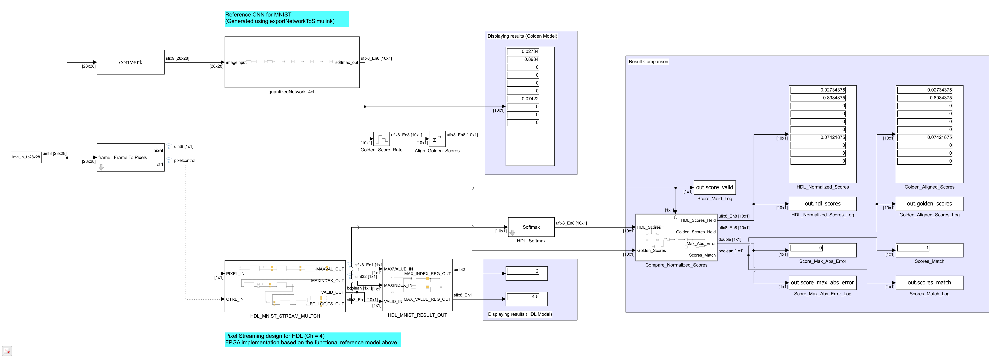
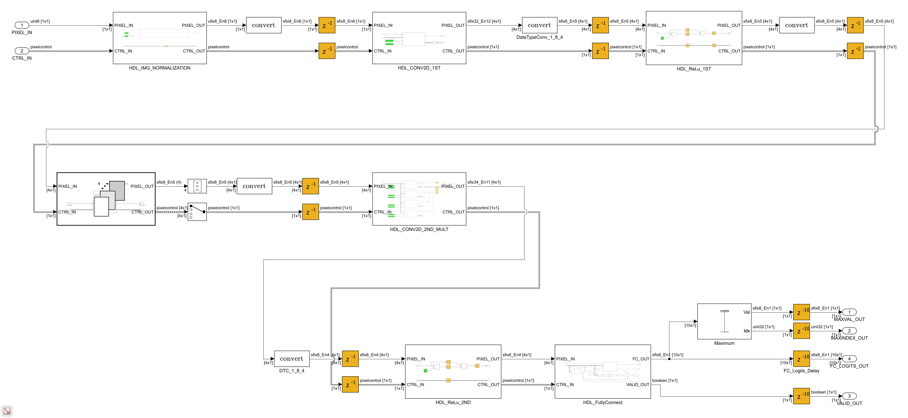

# Simulink MNIST HDL

A four-channel, fixed-point CNN built from Simulink blocks for streaming
handwritten-digit recognition. The model includes a quantized golden network,
the HDL-oriented pixel pipeline, and a Softmax comparison outside the HDL
code generation subsystem.



## Quick start

1. Clone this repository and open `MNIST_HDL.prj` in MATLAB.
2. Open `Model/quantizedNetwork_hdl.slx` if it is not already visible.
3. Click **Run** in Simulink.
4. At the model root, compare **HDL_Normalized_Scores** with
   **Golden_Aligned_Scores**. **Score_Max_Abs_Error** should be `0`, and
   **Scores_Match** should become `1` after the first valid result.

```matlab
project = openProject('MNIST_HDL.prj');
out = sim('quantizedNetwork_hdl');
```

The model already contains its network, fixed-point weights, biases, test input
and comparison parameters in **Model Workspace**. No training or setup script
is required before a normal run. Opening the project sets paths and opens the
model; it does not train, regenerate coefficients or run verification.

The default input is a stored 28-by-28 test pattern repeated every second.
Use `run_softmax_verification` to test digit images and boundary cases.
Clicking Run performs simulation. HDL generation, synthesis and board
programming are separate workflows.

## Requirements

The model and frozen reference were created with **MATLAB R2026b**.
Golden replay checks require the exact build recorded in
[`recipe.json`](Data/Golden/mnist_q8_v1/recipe.json):
`26.2.0.3386108 (R2026b)`. Other releases or builds require requalification.

The design uses MATLAB, Simulink, Deep Learning Toolbox, Fixed-Point Designer,
DSP System Toolbox and Vision HDL Toolbox. Network quantization also uses the
Deep Learning Toolbox Model Quantization Library. HDL Coder is required when
generating HDL. No FPGA board is required for simulation or score verification.

## Architecture



| Stage | Feature size | Operation |
|---|---|---|
| Input and normalization | 28 × 28 × 1 | uint8 input; normalization inside the network |
| Conv1 and ReLU1 | 26 × 26 × 4 | Four 3 × 3 filters, valid convolution |
| Max Pooling | 13 × 13 × 4 | 2 × 2 maximum, stride 2 |
| Conv2 and ReLU2 | 11 × 11 × 4 | Four input and four output channels |
| Fully Connected | 10 logits | Accumulate 484 features per class |
| Maximum | Value and class index | Select the largest logit |
| External Softmax | 10 normalized scores | Compare with the time-aligned golden scores |

The stream carries one spatial pixel per cycle. Four feature channels represent
the same spatial position. The control bus carries `valid`, `hStart`, `hEnd`,
`vStart` and `vEnd`. The current raster is 38 × 30 cycles per frame, with a
28 × 28 active image.

`HDL_MNIST_STREAM_MULTCH` exports `MAXVAL_OUT`, `MAXINDEX_OUT`, `VALID_OUT`
and `FC_LOGITS_OUT`. The class index is one-based: index 6 represents digit 5.
All four outputs have aligned delays. `HDL_Softmax` is outside this subsystem.

## Parameters and input data

| Item | Location / entry point |
|---|---|
| Active network, weights and biases | Model Workspace, saved in the SLX |
| Default image | Model Workspace: `img_in_tp28x28` |
| Test pattern definitions and geometry | `Script/HDLNN_setup.m` |
| Mapping quantized learnables to HDL coefficients | `Script/HDLNN_quantizedLearnables_setup.m` |
| Reload the frozen golden parameters | `initialize_hdl_model` |
| Score alignment | `SCORE_COMPARE_DELAY_CYCLES = 1203` |
| Pixel sample period | `SCORE_PIXEL_PERIOD = 1/1140` seconds |
| Maximum allowed score error | `SCORE_ABS_TOLERANCE = 0` |

To restore the frozen coefficients and standard inputs:

```matlab
receipt = initialize_hdl_model();
save_system('quantizedNetwork_hdl', 'SaveModelWorkspace', true);
```

Initialization updates Model Workspace in memory; saving is explicit. Running
`HDLNN_setup.m` by itself in the base workspace does not replace the model's
saved parameters. Supply custom inputs as 28 × 28 `uint8` images in the range
0–255; normalization is performed inside the network.

The 1203-cycle score alignment is specific to the current raster and pipeline:
48 cycles to the first active pixel plus 1155 processing cycles. Revalidate it
after changing timing or pipeline stages. Scores use the golden model's lookup
Softmax and `ufix8_En8` representation. Quantization means their sum need not
equal exactly 1.

## Verification

Run these commands from the open project:

```matlab
report = run_softmax_verification();
results = run_verification();
```

`run_softmax_verification` compares all ten scores for 26 images: two examples
of each digit plus all-zero, all-255, ramp, impulse, checkerboard and synthetic-5
patterns. It checks the saved golden values and types, one valid pulse per
frame, timing, held displays and detection of an intentionally misaligned
reference. Inputs are applied with `Simulink.SimulationInput` without changing
the saved model. Results are written to a new `Results/` subfolder.

`run_verification` runs 17 portable integrity and golden-replay tests, including
the standalone golden model's compilation. Older campaign scripts that require
archived results or a locally installed agent toolkit are not part of this
repository's supported workflow.

Repository preparation verified all 17 tests and all 260 scores, with maximum
absolute error zero. The source model hash and screenshot provenance are recorded
in [`capture_metadata.json`](Docs/images/capture_metadata.json).

The frozen baseline is `mnist_q8_v1`. It uses the **MathWorks DigitDataset
bundled with MATLAB**, rather than a separate download of canonical MNIST.
The 26 replay images are included. The full dataset is needed only for
explicit retraining. Golden bundle hashes are verified before loading;
do not edit its files or let Git normalize their line endings.

## Repository contents

| Path | Purpose |
|---|---|
| `MNIST_HDL.prj`, `resources/project/` | Portable MATLAB project definition |
| `Model/` | Current HDL-oriented Simulink design |
| `Script/` | Startup, parameter loading and verification entry points |
| `Script/Verification/+mnistverify/` | Required reference and comparison helpers |
| `Data/Golden/` | Frozen network, inputs, expected scores and provenance |
| `Test/` | Portable integrity and golden-replay tests |
| `Docs/images/` | Captures from the committed SLX |
| `resources/repository_files.txt` | Files registered with the MATLAB project |

Git tracks the reproducible design and its reference data. Caches, generated
code, simulation outputs, backups, investigation logs, old presentations and
historical experiments remain local. `.gitignore` uses an explicit source
allowlist; update it and `resources/repository_files.txt` when adding assets.
Use `configure_project` if project paths or registered files need refreshing.

The HDL architecture is supplied for design and simulation. Successful score
comparison is not a claim of HDL/RTL equivalence, timing closure or hardware
validation.
